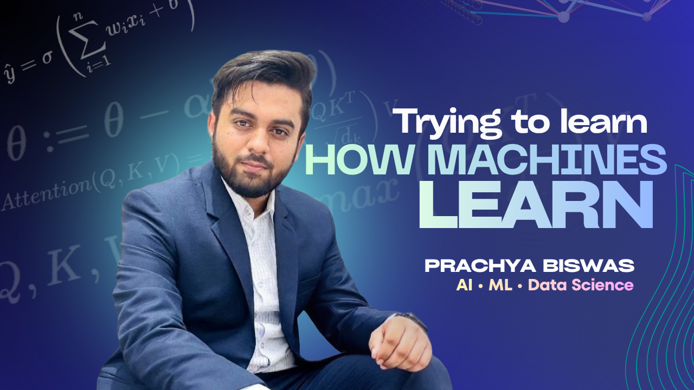

  

  

<h2 align="left">
  Hello World 
</h2>

  

  
  
  

---

## About Me

- 🔬 Research Secretary at **ML & AI Research Lab, Bangladesh**
- 🧮 Academic Team Member & Problem Setter at **Bangladesh Mathematical Olympiad**
- ⚡ **Secretariat** at **IEEE BRAC University Student Branch**
- 🏆 Honored with the **Certificate of Excellence 2026** for Academic Team contributions at **Bangladesh Mathematical Olympiad**
- 🥇 Former **Regional Math Olympiad Champion**
- 🔗 **Finalist**, Bangladesh Blockchain and AI Olympiad (**BBAIO**) — AI category
- 📊 **Participant**, International Data Science Olympiad (**IDSOL**)
- 🤖 Learning and building in **Machine Learning**, **Deep Learning**, and **Data Science**
- 💻 Comfortable with **Python, Java, NumPy, Pandas, scikit-learn** and **Jupyter Notebook**
- 🧠 Currently exploring agentic AI tooling (**Google Antigravity**) and shipping full-stack ML projects end to end
- ✨ I enjoy solving problems and writing clean, reproducible code.

---

## 🛠️ Tech Stack

  

  

  

  

  

  

  

  

  

  

---

## 📊 GitHub Stats

  

  

 

  

---

## 🚀 Featured Projects

| Project | Description |
|---|---|
| 🏥 [**MediSense BD**](https://github.com/prachyabiswas/MediSense-BD) | National health / epidemic forecasting platform — implemented the **TRACE** prediction model as the team's data scientist |
| ♻️ [**Vangari AI**](https://github.com/prachyabiswas/Vangari-AI) | AI-powered waste marketplace for **IDSOL 2026** — vision-based material classification, geo-dispatch, and fair-payout pricing |
| 🏦 [**Loan Prediction using ML**](https://github.com/prachyabiswas/Loan-Prediction-using-Machine-Learning) | Loan approval prediction using classic ML algorithms, with full EDA and model comparison |
| 🥔 [**Potato Disease Classification**](https://github.com/prachyabiswas/DISEASE-CLASSIFICATION) | Image classification pipeline using **CNNs**, with data augmentation and model evaluation |
| 📘 [**Java → Python Guide**](https://github.com/prachyabiswas/Java-to-Python-Guide) | A side-by-side Java ↔ Python code-equivalence reference, written while transitioning into Python for ML/data science |
| 🤖 [**Google Antigravity Tutorial**](https://github.com/prachyabiswas/Google-Antigravity-Tutorial) | Beginner-to-advanced guide to Google's agent-first AI coding IDE |

---

  

  <a href="#top">
    ⬆️ Back to top
  </a>

